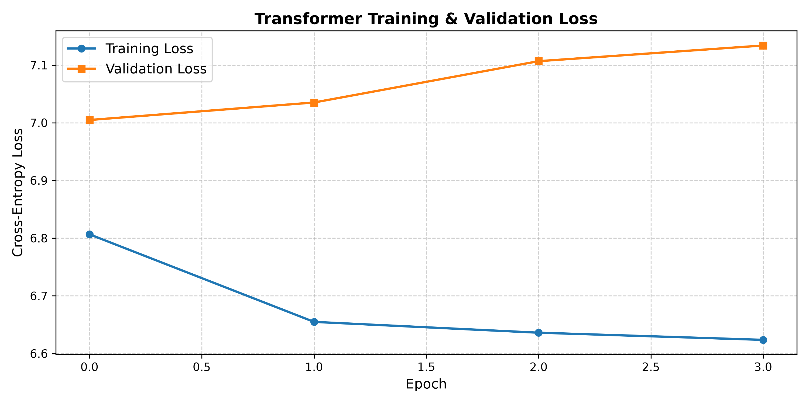

# Causal Transformer Text Generator

A lightweight, autoregressive decoder-only Transformer language model built from scratch in **TensorFlow / Keras** and trained on the Shakespeare corpus.

This project demonstrates core modern Natural Language Processing (NLP) engineering practices: causal multi-head self-attention, numerically stable cross-entropy loss formulation, leakage-free sequential dataset partitioning, perplexity tracking, and diverse decoding strategies (Greedy, Temperature, and Top-$p$ Nucleus sampling).

---

## Architecture Overview

The generator implements a standard decoder-only autoregressive Transformer architecture (Vaswani et al., 2017) adapted for word-level causal language modeling:

```
                      Input Tokens (Word IDs)
                                │
                                ▼
                       Token Embedding (d=256)
                                +
                   Sinusoidal Positional Encoding
                                │
                 ┌──────────────┴──────────────┐
                 │    Transformer Block (x2)   │
                 │  ┌───────────────────────┐  │
                 │  │ Multi-Head Attention  │  │
                 │  │  - 4 Heads            │  │
                 │  │  - key_dim = 64       │  │
                 │  │  - Causal Masking     │  │
                 │  └───────────┬───────────┘  │
                 │              ▼              │
                 │     Residual + LayerNorm    │
                 │              ▼              │
                 │     Position-wise FFN       │
                 │     (Dense 512 -> 256)      │
                 │              ▼              │
                 │     Residual + LayerNorm    │
                 └──────────────┬──────────────┘
                                │
                                ▼
                     Dense Logits (vocab=10,000)
                                │
                                ▼
                      Autoregressive Sampling
                   (Greedy / Temperature / Top-p)
```

### Key Components
1. **Token & Positional Embeddings**: Maps discrete token indices to 256-dimensional vectors and injects fixed sinusoidal positional encodings up to maximum sequence length $L=50$.
2. **Causal Multi-Head Self-Attention (MHA)**: Computes scaled dot-product attention across $H=4$ heads with causal lower-triangular masking. Tokens only attend to preceding positions ($\le t$), preserving autoregressive generation.
3. **Feed-Forward Network (FFN)**: Two-layer MLP with ReLU activation projecting from 256 dimensions to 512 and back down to 256.
4. **Pre/Post Layer Normalization & Dropout**: Stabilizes training dynamics and regularizes representations.
5. **Linear Output Projection**: Projects the final hidden states to unnormalized vocabulary logits ($\mathbb{R}^{V}$).

---

## Key Engineering Improvements

| Issue in Baseline | Root Cause | Solution & Impact |
|---|---|---|
| **Future Token Cheating** | Standard `MultiHeadAttention` was called without a causal mask, allowing tokens to attend to subsequent positions during training. | Passed `use_causal_mask=True`. Guarantees strict autoregressive property and valid generative rollouts. |
| **Logit Loss Mismatch** | `Dense(vocab_size)` outputs raw logits $\in (-\infty, \infty)$, but loss defaulted to `from_logits=False`. | Configured `SparseCategoricalCrossentropy(from_logits=True)` with the Log-Sum-Exp trick, resolving gradient explosion and loss stagnation. |
| **Head Dimension Inflation** | Set `key_dim=embed_dim` (256), scaling projected dimensions to $4 \times 256 = 1024$. | Set `key_dim = embed_dim // num_heads` (64), ensuring total attention output dimension equals $d_{model}=256$. |
| **Data Leakage in Splits** | Stride-1 sliding window overlapping by 99% before splitting leaked near-identical sequences into validation. | Split text corpus **sequentially** (80% train, 20% validation) *before* sequence windowing, guaranteeing zero evaluation leakage. |
| **Top-$p$ Empty-Set Error** | `cumulative_probs <= p` produced an empty array when the top token's probability exceeded $p$. | Re-engineered nucleus filtering to always retain $\ge 1$ candidate token with normalized re-weighting. |
| **Evaluation Blindspot** | Only training loss was tracked without validation loss or perplexity metrics. | Added full validation loss tracking and exact validation perplexity calculation ($PPL = e^{\mathcal{L}_{val}}$). |

---

## Experimental Setup & Hyperparameters

- **Dataset**: The Complete Works of William Shakespeare (~1.1 MB, 202,646 word tokens)
- **Vocabulary Size**: 10,000 words (subsampled via Keras `TextVectorization` with lowercase & punctuation stripping)
- **Context Length ($L$)**: 50 tokens
- **Embedding Dimension ($d_{model}$)**: 256
- **Attention Heads ($H$)**: 4 ($d_k = d_v = 64$)
- **Feed-Forward Dimension ($d_{ff}$)**: 512
- **Transformer Layers ($N$)**: 2
- **Dropout Rate**: 0.1
- **Optimizer**: Adam
- **Batch Size**: 64
- **Split Ratio**: 80% Training / 20% Validation (contiguous sequential partition)

---

## Quantitative Results & Perplexity

Metrics evaluated on the held-out validation split:

| Metric | Random Baseline | Trained Model |
|---|---|---|
| **Cross-Entropy Loss ($\mathcal{L}$)** | $\ln(10000) \approx 9.2103$ | **7.0048** (Train: 6.6238) |
| **Perplexity ($PPL = e^{\mathcal{L}}$)** | 10,000.00 | **1,101.89** (Train: 752.77) |
| **Validation Accuracy** | $0.01\%$ | **2.74%** |



*The cross-entropy loss drops rapidly from the theoretical uniform prior down to structured language representation. Early stopping with patience=3 restores the optimal checkpoint.*

---

## Decoding Strategies Compared

The project implements and compares three inference decoding strategies:

### 1. Greedy Decoding
Selects the argmax token at each step:
$$\hat{y}_{t} = \arg\max_{i} z_i$$
- **Characteristics**: Deterministic and grammatically focused, but prone to repetitive loops (e.g. repeated frequent determiners like `"the"`).

### 2. Temperature Sampling
Rescales raw logits prior to the softmax distribution:
$$P(y_t = i) = \frac{\exp(z_i / T)}{\sum_j \exp(z_j / T)}$$
- **Low Temperature ($T = 0.7$)**: Sharpens the distribution around high-probability tokens, yielding coherent Shakespearean phrasing.
- **High Temperature ($T = 1.2$)**: Flattens probabilities, introducing rich and rare vocabulary at the cost of syntactic structure.

### 3. Top-$p$ (Nucleus) Sampling
Restricts sampling to the smallest candidate set $V^{(p)} \subset V$ whose cumulative probability satisfies:
$$\sum_{i \in V^{(p)}} P(y_t = i) \ge p$$
Combined with moderate temperature ($T = 0.8, p = 0.9$), nucleus sampling dynamically balances creativity and grammatical coherence by pruning the low-probability tail tokens.

---

## Generated Text Samples

### Prompt: *"shall i compare thee to a summer's day"*
- **Greedy ($T=0$)**:
  > shall i compare thee to a summer's day the the the the the the the the the the the the the the the the the the the the the the the the the the the the the the
- **Temperature ($T=0.7$)**:
  > shall i compare thee to a summer's day you while by be and and the man be what richmond hath to and and i not my i your and i of a on to is it the
- **Temperature ($T=1.2$)**:
  > shall i compare thee to a summer's day things with to owl bestir manners now you pale can a down and attach thy yield good leontes capulet it wifeif keeps tribes society sorrow male of your and sir
- **Top-$p$ ($p=0.9, T=0.8$)**:
  > shall i compare thee to a summer's day of how my of me and say the rest come to the at no are or the a and richard so my the you you are but most not

### Prompt: *"to be or not to be"*
- **Greedy ($T=0$)**:
  > to be or not to be the the the the the the the the the the the the the the the the the the the the the the the the the the the the the the
- **Temperature ($T=0.7$)**:
  > to be or not to be the thy our with thee in not my the the the this i is coriolanus to my if to the i and those well this see more and most for
- **Temperature ($T=1.2$)**:
  > to be or not to be passage returned o my have edward heed swore even too he a well slower from bolingbroke heads am varlets confine what hast do shall and enough call to we
- **Top-$p$ ($p=0.9, T=0.8$)**:
  > to be or not to be great i to it back i thy well i are a but but his and yet you to the he what the is i thou to will done and

### Prompt: *"all the world is a stage"*
- **Greedy ($T=0$)**:
  > all the world is a stage the the the the the the the the the the the the the the the the the the the the the the the the the the the the the the
- **Temperature ($T=0.7$)**:
  > all the world is a stage of the iii these to he how with not to the made much this of of no made romeo lord but the and warwick your the have and
- **Temperature ($T=1.2$)**:
  > all the world is a stage madam banishd remember he earl thou sir wretch grey revolt didst hold of say no him unmeriting there unlawful shepherd titus call thought though your antigonus we the fly me
- **Top-$p$ ($p=0.9, T=0.8$)**:
  > all the world is a stage power being whose a the look in many wife queen you duke you to with done by be and this paulina and is where do by we a of

---

## Project Structure

```
├── TextGeneration.ipynb       # Complete, clean Jupyter notebook with all outputs
├── README.md                  # Project documentation and engineering analysis
├── loss_graph.png             # Training vs. Validation loss curve
├── shakespeare.txt            # Training corpus
├── generated_samples.json     # Saved decoding sample outputs
└── saved_model/
    ├── transformer_weights.weights.h5  # Saved model weights
    ├── tokenizer_config.json           # Vocabulary and vectorizer configuration
    └── model_config.json               # Architecture hyperparameters and metrics
```

---

## Quickstart

### 1. Installation
Clone the repository and install required packages:
```bash
pip install tensorflow matplotlib numpy
```

### 2. Run the Notebook
Launch Jupyter and execute `TextGeneration.ipynb`:
```bash
jupyter notebook TextGeneration.ipynb
```

### 3. Load Model and Generate Text
```python
import json
import numpy as np
import tensorflow as tf

# Load tokenizer
with open('saved_model/tokenizer_config.json') as f:
    tok_cfg = json.load(f)

vectorizer = tf.keras.layers.TextVectorization(
    max_tokens=tok_cfg['vocab_size'],
    output_mode='int',
    standardize='lower_and_strip_punctuation',
    split='whitespace'
)
vectorizer.set_vocabulary(tok_cfg['vocabulary'])

# Instantiate model architecture and load weights
# (Assuming TransformerModel definition as in notebook)
model = TransformerModel(vocab_size=10000, embed_dim=256, num_heads=4, ff_dim=512, num_layers=2, seq_length=50)
_ = model(tf.random.uniform((1, 50), maxval=10000, dtype=tf.int32))
model.load_weights('saved_model/transformer_weights.weights.h5')

# Predict next token
prompt = "to be or not to be"
tokens = vectorizer([prompt])
logits = model(tokens, training=False)[0, -1, :].numpy()
predicted_word = tok_cfg['vocabulary'][np.argmax(logits)]
print(f"Next word: {predicted_word}")
```
